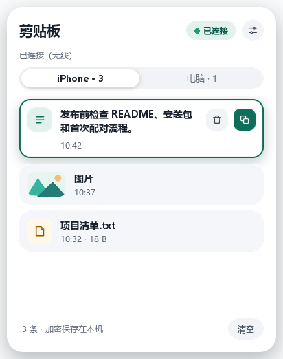

# CopiaGo

**English** · [简体中文](README.zh-CN.md)

Copy on your iPhone and paste directly into Windows apps. Pair once over USB, then sync wirelessly on the same local network. Your iPhone needs no companion app.

**[Download the Windows x64 installer](https://github.com/xgod1862/CopiaGo/releases/latest)** · [Detailed user guide (Chinese)](source/README.md)

## Quick start

1. Run the installer on Windows. If CopiaGo asks for Apple connection components, install [Apple Devices](https://support.apple.com/en-us/118290).
2. Connect your iPhone with a USB cable and unlock it. Tap **Trust** if your iPhone prompts you, and enable [Developer Mode](https://developer.apple.com/documentation/xcode/enabling-developer-mode-on-a-device) when CopiaGo asks.
3. Select **Connect iPhone** (「连接 iPhone」) in CopiaGo. Once pairing is complete, unplug the cable and wait for the tray panel to show **Connected (Wi-Fi)** (「已连接（无线）」).
4. Copy some text on your iPhone and press `Ctrl+V` in a Windows app.

The installer and CopiaGo use your Windows display language to choose English or Simplified Chinese. In CopiaGo, open **Settings → Language** to follow Windows or choose a language manually. Settings are also available from the pairing screen.

## Screenshots

| First-time pairing | System tray popup | Clipboard history |
| --- | --- | --- |
| [](docs/images/first-pairing.png) | [](docs/images/tray-popup.png) | [](docs/images/clipboard-history.png) |

These screenshots show CopiaGo 1.0.0 running with its Chinese interface. The connection state and clipboard entries use sample data. Click an image to view it at full size.

## What syncs

| Direction | Supported content | Default behavior |
| --- | --- | --- |
| iPhone → Windows | Text, images, and files copied from the Files app | Syncs automatically, with confirmation for large files |
| Windows → iPhone | Text and images | Automatic sync is off by default. Enable it in Settings or send items manually from Windows clipboard history. |

- Both clipboard histories are off by default. Enable either history to view and clear it from the Windows system tray.
- CopiaGo uses the iPhone's system clipboard developer service, so compatibility depends on the iOS version. For wireless sync, both devices must be able to discover each other on the local network.
- Image pasting depends on what the source app puts on the clipboard. If it only provides text or a filename, save the image to Photos and copy it from there. Copying videos from Photos is currently unsupported.

## Privacy

- Wireless sync uses an encrypted tunnel to the paired iPhone. Clipboard contents do not go through a cloud relay.
- [Windows DPAPI](https://learn.microsoft.com/en-us/windows/win32/api/dpapi/nf-dpapi-cryptprotectdata) protects pairing records and, when history is enabled, saved clipboard contents and previews. Received files are temporarily stored in the data directory's `received` folder.
- Pair only with Windows computers you trust. When you stop using CopiaGo on a computer, select **Forget this iPhone** (「忘记此 iPhone」) in the tray settings.

## Run or build from source

Use 64-bit Python 3.12 with Tk. Building the installer also requires Inno Setup 6.

```powershell
Set-Location source
py -3.12 -m venv ..\.venv
$python = '..\.venv\Scripts\python.exe'
& $python -m pip install -r requirements.txt
& $python -m unittest discover -s tests
& $python main.py
```

Run the following commands from `source` to build the executable and installer.

```powershell
$root = (Resolve-Path ..).Path
.\build.ps1 -Python $python -DistPath ..\build\dist -BuildPath ..\build\work
& 'C:\Program Files (x86)\Inno Setup 6\ISCC.exe' "/DRoot=$root" .\setup.iss
```

If Inno Setup is installed elsewhere, replace the path to `ISCC.exe`. The installer is written to the `release` directory at the repository root.

## Feedback and license

Report issues through [GitHub Issues](https://github.com/xgod1862/CopiaGo/issues/new). Include your Windows, iOS, and CopiaGo versions and steps to reproduce the issue. Remove pairing records, clipboard contents, and other personal information before posting.

CopiaGo is licensed under [GPL-3.0-or-later](LICENSE). See the [third-party licenses](source/licenses) for the notices shipped with the installer. Thanks to [pymobiledevice3](https://github.com/doronz88/pymobiledevice3), [Relais](https://github.com/williamcachamwri/Relais), and the [Inno Setup Simplified Chinese translation](https://github.com/kira-96/Inno-Setup-Chinese-Simplified-Translation) project.
