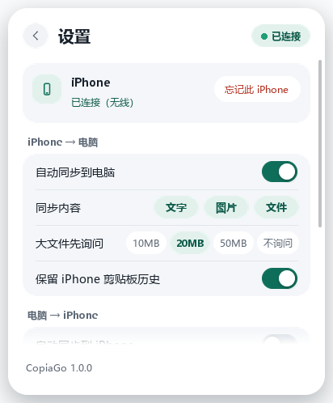

# CopiaGo

在 iPhone 上复制，在 Windows 上直接粘贴。首次用 USB 配对，之后在同一局域网内无线同步。iPhone 无需安装 App。

**[下载安装包（Windows x64）](https://github.com/xgod1862/CopiaGo/releases/latest)** · [详细使用指南](source/README.md)

## 快速开始

1. 在 Windows 运行安装包。若应用提示缺少 Apple 连接组件，可安装 [Apple Devices](https://support.apple.com/en-us/118290)。
2. 用数据线连接并解锁 iPhone。按手机提示点「信任」，按 CopiaGo 提示开启 [开发者模式](https://developer.apple.com/documentation/xcode/enabling-developer-mode-on-a-device)。
3. 在 CopiaGo 中点击「连接 iPhone」。配对完成后拔线，等托盘面板显示「已连接（无线）」。
4. 在 iPhone 上复制一段文字，在 Windows 应用中按 `Ctrl+V`。

## 界面截图

| 首次配对 | 托盘弹窗 | 剪贴板历史 |
| --- | --- | --- |
| [](docs/images/first-pairing.png) | [](docs/images/tray-popup.png) | [](docs/images/clipboard-history.png) |

截图来自运行中的 CopiaGo 1.0.0，连接状态和历史记录使用示例数据。点击图片可查看原图。

## 同步范围

| 方向 | 内容 | 默认行为 |
| --- | --- | --- |
| iPhone → Windows | 文字、图片、「文件」App 中复制的文件 | 自动同步，大文件先询问 |
| Windows → iPhone | 文字、图片 | 在设置里开启自动同步，或从电脑历史手动发送 |

- 双端历史默认关闭，开启后可在 Windows 托盘面板查看和清除。
- CopiaGo 依赖 iPhone 的系统剪贴板开发者服务，兼容性取决于 iOS 版本。使用无线同步时，两台设备需在可互相发现的局域网上。
- 能否粘贴图片取决于来源应用提供的剪贴板内容。若应用只提供文字或文件名，可先保存到「照片」再复制。照片 App 中的视频复制暂不支持。

## 隐私

- 无线传输走已配对设备的加密隧道。CopiaGo 不使用云端中转剪贴板。
- 配对记录及启用后的历史正文与预览由 [Windows DPAPI](https://learn.microsoft.com/en-us/windows/win32/api/dpapi/nf-dpapi-cryptprotectdata) 保护。接收的文件会暂存在数据目录的 `received` 文件夹。
- 仅在可信的 Windows 电脑上配对。停用时可在托盘设置中选「忘记此 iPhone」。

## 从源码运行或构建

使用带 Tk 的 64 位 Python 3.12。打包安装程序另需 Inno Setup 6。

```powershell
Set-Location source
py -3.12 -m venv ..\.venv
$python = '..\.venv\Scripts\python.exe'
& $python -m pip install -r requirements.txt
& $python -m unittest discover -s tests
& $python main.py
```

在 `source` 目录构建可执行文件和安装包：

```powershell
$root = (Resolve-Path ..).Path
.\build.ps1 -Python $python -DistPath ..\build\dist -BuildPath ..\build\work
& 'C:\Program Files (x86)\Inno Setup 6\ISCC.exe' "/DRoot=$root" .\setup.iss
```

如果 Inno Setup 安装在其他位置，请替换 `ISCC.exe` 路径。生成的安装包位于仓库根目录的 `release`。

## 反馈与许可

通过 [GitHub Issues](https://github.com/xgod1862/CopiaGo/issues/new) 反馈。请附上 Windows、iOS、CopiaGo 版本和复现步骤，并移除配对记录、剪贴板内容及其他个人信息。

项目采用 [GPL-3.0-or-later](LICENSE)。随安装包分发的许可声明见 [第三方许可目录](source/licenses)。感谢 [pymobiledevice3](https://github.com/doronz88/pymobiledevice3)、[Relais](https://github.com/williamcachamwri/Relais) 和 [Inno Setup 简体中文翻译](https://github.com/kira-96/Inno-Setup-Chinese-Simplified-Translation)。
