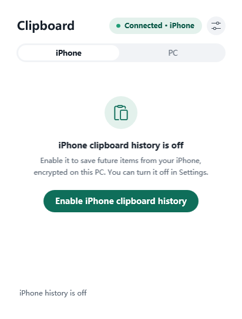
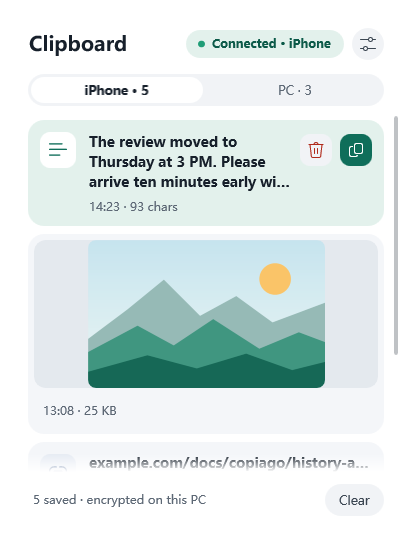

# CopiaGo

**English** · [简体中文](README.zh-CN.md)

Copy on your iPhone and paste directly into Windows apps. Pair once over USB, then sync wirelessly on the same local network. Your iPhone needs no companion app.

**[Download the Windows x64 installer](https://github.com/xgod1862/CopiaGo/releases/latest)**

## Requirements

| | Requirement |
| --- | --- |
| iPhone | **iOS 17 or later** (iPhone XS / XR and newer). Developer Mode must be on; CopiaGo walks you through it. If the switch is not in Settings yet, CopiaGo makes it appear once the phone is connected by USB; turning it on and restarting still happen on the phone. **iOS 16 and earlier are not supported**, and pairing tells you to update. |
| Windows | **Windows 10 21H2 (build 19044) or later, including Windows 11**, x64. Apple's device connection components (Apple Mobile Device Support) are required. If they are missing, select **Install Apple support** in CopiaGo to install them with the Windows Package Manager (winget). On PCs without winget or Microsoft Store (such as LTSC or trimmed editions), select **Download manually** to get [Apple Devices](https://support.apple.com/en-us/118290) from Microsoft Store, or iTunes from apple.com. |
| Network | First-time pairing needs a USB cable. Wireless sync then needs the PC and iPhone on the same local network, able to discover each other; a VPN or a proxy "TUN mode" on the PC can block local connections. The first developer-service setup downloads about 18 MB and requests a signature from Apple. |

## Size and resource use

1.3.0 is a Rust rewrite. Compared with the Python-based 1.2.0:

| | 1.3.0 | 1.2.0 (Python) |
| --- | ---: | ---: |
| Installer | 3.7 MB | 25 MB |
| Portable ZIP | 1.9 MB | — |
| Installed size | 7.9 MB (3.4 MB app; the rest is the uninstaller) | 74 MB |
| Memory in the tray | about 3.5 MB | about 71 MB |
| Memory with the panel open | about 10–12 MB | — |
| CPU when idle | about 0.1% of one logical core | — |
| Launch to connected over Wi-Fi | about 2 seconds | — |

Memory is process private memory (private commit), measured on Windows 11 x64 with a real iPhone connected over Wi-Fi. After the panel closes, CopiaGo returns that memory, and Task Manager shows about 3 MB. The developer components (about 18 MB) are downloaded to the data folder on first connection and are not counted in the installed size.

## Quick start

1. Run the installer on Windows.
2. Connect your iPhone with a USB cable and unlock it. Tap **Trust** if your iPhone prompts you, and enable [Developer Mode](https://developer.apple.com/documentation/xcode/enabling-developer-mode-on-a-device) when CopiaGo asks.
3. Select **Connect iPhone** in CopiaGo. Once pairing is complete, unplug the cable and wait for the tray panel to show **Connected (Wi-Fi)**.
4. Copy some text on your iPhone and press `Ctrl+V` in a Windows app.

The installer and CopiaGo use your Windows display language to choose English or Simplified Chinese. In CopiaGo, open **Settings → Language** to follow Windows or choose a language manually.

### If connecting fails

When a step fails, CopiaGo shows the reason and what to do next. These problems can be fixed from inside the app:

- **The Apple connection service is stopped, disabled, or not responding**: select **Repair connection service**. After administrator approval, CopiaGo starts or restarts Apple Mobile Device Service and sets it back to start with Windows (Apple's default). If another program uses port 27015, CopiaGo names it.
- **Windows sees the iPhone, but the Apple USB driver is not working**: select **Repair Apple driver**. After administrator approval, CopiaGo uses the built-in `pnputil` to reinstall the USB driver that comes with Apple's components.
- **Windows does not see the iPhone**: usually a charge-only cable or a port problem. Try another cable, or plug directly into the PC.

If it still does not connect, select **Copy diagnostics** in the guide or Settings and send the text to the developer. Or select **Report a problem**: CopiaGo copies the diagnostics and opens a prefilled GitHub issue (a GitHub account is required), where you paste them into the description.

### Upgrading

Run the new installer over the old version. Pairing records, history and settings are kept, so you don't need to pair again. Installations in the old default folder `%LOCALAPPDATA%\Programs\iPhoneClipboard` move to `%LOCALAPPDATA%\Programs\CopiaGo`; a folder you chose yourself stays where it is.

## Screenshots

| First-time pairing | System tray popup | Clipboard history |
| --- | --- | --- |
| [](docs/images/first-pairing-en.png) | [](docs/images/tray-popup-en.png) | [](docs/images/clipboard-history-en.png) |

Screenshots are from CopiaGo 1.3.0 with sample connection status and history.

## What syncs

| Direction | Content | Default behavior |
| --- | --- | --- |
| iPhone → Windows | Text, images, and files copied in the Files app | Syncs automatically; asks before large files |
| Windows → iPhone | Text and images | Turn on automatic sync in Settings, or send items from PC history |

- History for both directions is off by default. Once on, you can view, copy, send and clear it from the Windows tray panel.
- Image pasting depends on what the source app puts on the clipboard. If an app provides only text or a file name, save the image to Photos first and copy it there. Copying videos from the Photos app is not supported yet.
- When your iPhone leaves the network, CopiaGo reconnects as soon as it is back, without opening the panel.

## Privacy

- Wireless transfers use the encrypted tunnel to the paired device. CopiaGo does not relay clipboard data through a cloud service.
- [Windows DPAPI](https://learn.microsoft.com/en-us/windows/win32/api/dpapi/nf-dpapi-cryptprotectdata) protects pairing records and, when history is on, history content and previews. Received files are staged in the `received` folder in the data directory.
- Pair only with a Windows PC you trust. When you stop using CopiaGo, select **Forget this iPhone** in Settings.
- About 15 seconds after each launch, CopiaGo checks GitHub once for a newer version. If one is available, the tray panel shows a notice at the bottom; nothing is downloaded or installed automatically. GitHub can see this PC's IP address and the CopiaGo version. Turn off **Check for updates at startup** in Settings to disable it.
- During the first developer-service setup, CopiaGo tries raw.githubusercontent.com, ghfast.top (a third-party GitHub mirror) and fastly.jsdelivr.net in turn, and checks every file against a fixed SHA-256. It then requests a signature from Apple's signing server. These services can see this PC's IP address.
- CopiaGo writes a diagnostic log, `diagnostic.log`, in the data directory (rotated at 512 KB, about 1 MB at most). It records event types, stages, error categories and numbers only; never clipboard content, file names, the iPhone's name, serial numbers or file paths. The log stays on this PC. It is copied to the clipboard only when you select **Copy diagnostics** or **Report a problem**, and you decide whether to send it. The copied text also includes the Windows and CopiaGo versions and the iPhone model and iOS version; review it before sending.
- Administrator approval is requested only after you select the matching button, and Windows always confirms it. If **Connect iPhone** finds a problem with the Apple service, CopiaGo only explains it and points you to **Repair connection service**. These actions are: installing Apple's components (through winget, which accepts Apple's license on your behalf), starting the Apple connection service and setting it back to start automatically, and reinstalling the Apple USB driver.
- Developer Mode relaxes some iPhone security restrictions and must stay on while you use CopiaGo. When you no longer need it, turn it off in **Settings → Privacy & Security → Developer Mode** on the iPhone.
- Uninstalling asks whether to delete the data directory, including pairing records, history, settings and the diagnostic log.

## Building from source

CopiaGo is written in Rust; the source is in [`copiago-rs`](copiago-rs). Install [rustup](https://rustup.rs/); `rust-toolchain.toml` selects the toolchain.

```powershell
Set-Location copiago-rs
cargo test --workspace --locked
cargo build --release --locked
```

Packaging the installer and portable ZIP also needs [Inno Setup 6](https://jrsoftware.org/isinfo.php). From the repository root:

```powershell
.\copiago-rs\scripts\build.ps1 -IsccPath 'C:\Program Files (x86)\Inno Setup 6\ISCC.exe'
```

Packages are written to `copiago-rs\target\packages`. See [copiago-rs/README.md](copiago-rs/README.md) for build, test and upgrade-verification details. The Python code for 1.2.0 and earlier remains in git history and at the [`v1.2.0`](https://github.com/xgod1862/CopiaGo/tree/v1.2.0) tag.

## Feedback and license

Select **Report a problem** in the app, or report through [GitHub Issues](https://github.com/xgod1862/CopiaGo/issues/new) directly. Include the text from **Copy diagnostics** and steps to reproduce the issue. Do not attach pairing record files, clipboard contents, or other personal information.

CopiaGo is licensed under [GPL-3.0-or-later](LICENSE). Third-party notices distributed with the installer are installed in the `licenses` folder of the program directory. Thanks to [idevice](https://github.com/jkcoxson/idevice), [pymobiledevice3](https://github.com/doronz88/pymobiledevice3), [Relais](https://github.com/williamcachamwri/Relais), and the [Inno Setup Simplified Chinese translation](https://github.com/kira-96/Inno-Setup-Chinese-Simplified-Translation).
