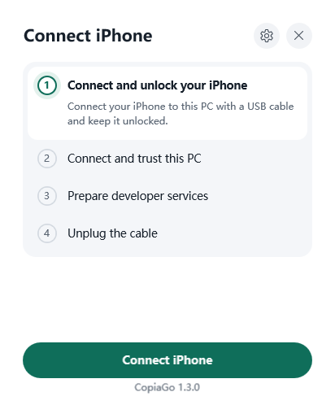

# CopiaGo

**English** · [简体中文](README.zh-CN.md)

Copy on your iPhone and paste directly into Windows apps. Pair once over USB, then sync wirelessly on the same local network. Your iPhone needs no companion app.

**[Download the Windows x64 installer](https://github.com/xgod1862/CopiaGo/releases/latest)**

## Requirements

| | Requirement |
| --- | --- |
| iPhone | **iOS 17 or later** (iPhone XS / XR and newer). Developer Mode must be on; CopiaGo walks you through it. **iOS 16 and earlier are not supported.** |
| Windows | **Windows 10 21H2 (build 19044) or later, including Windows 11**, x64. Apple's device connection components are required; CopiaGo prompts you to install [Apple Devices](https://support.apple.com/en-us/118290) if they are missing. |
| Network | First-time pairing needs a USB cable. Wireless sync then needs the PC and iPhone on the same local network, able to discover each other. The first developer-service setup downloads about 18 MB and requests a signature from Apple. |

## Quick start

1. Run the installer on Windows.
2. Connect your iPhone with a USB cable and unlock it. Tap **Trust** if your iPhone prompts you, and enable [Developer Mode](https://developer.apple.com/documentation/xcode/enabling-developer-mode-on-a-device) when CopiaGo asks.
3. Select **Connect iPhone** in CopiaGo. Once pairing is complete, unplug the cable and wait for the tray panel to show **Connected (Wi-Fi)**.
4. Copy some text on your iPhone and press `Ctrl+V` in a Windows app.

The installer and CopiaGo use your Windows display language to choose English or Simplified Chinese. In CopiaGo, open **Settings → Language** to follow Windows or choose a language manually.

### Upgrading

Run the new installer over the old version. Pairing records, history and settings are kept, so you don't need to pair again. Installations in the old default folder `%LOCALAPPDATA%\Programs\iPhoneClipboard` move to `%LOCALAPPDATA%\Programs\CopiaGo`; a folder you chose yourself stays where it is.

## Screenshots

| First-time pairing | System tray popup | Clipboard history |
| --- | --- | --- |
| [](docs/images/first-pairing-en.png) | [](docs/images/tray-popup-en.png) | [](docs/images/clipboard-history-en.png) |

Screenshots are from CopiaGo 1.3.0 with sample connection status and history.

## What syncs

| Direction | Content | Default behavior |
| --- | --- | --- |
| iPhone → Windows | Text, images, and files copied in the Files app | Syncs automatically; asks before large files |
| Windows → iPhone | Text and images | Turn on automatic sync in Settings, or send items from PC history |

- History for both directions is off by default. Once on, you can view, copy, send and clear it from the Windows tray panel.
- Image pasting depends on what the source app puts on the clipboard. If an app provides only text or a file name, save the image to Photos first and copy it there. Copying videos from the Photos app is not supported yet.
- When your iPhone leaves the network, CopiaGo reconnects as soon as it is back, without opening the panel.

## Privacy

- Wireless transfers use the encrypted tunnel to the paired device. CopiaGo does not relay clipboard data through a cloud service.
- [Windows DPAPI](https://learn.microsoft.com/en-us/windows/win32/api/dpapi/nf-dpapi-cryptprotectdata) protects pairing records and, when history is on, history content and previews. Received files are staged in the `received` folder in the data directory.
- Pair only with a Windows PC you trust. When you stop using CopiaGo, select **Forget this iPhone** in Settings.
- About 15 seconds after each launch, CopiaGo checks GitHub once for a newer version. If one is available, the tray panel shows a notice at the bottom; nothing is downloaded or installed automatically. GitHub can see this PC's IP address and the CopiaGo version. Turn off **Check for updates at startup** in Settings to disable it.

## Building from source

CopiaGo is written in Rust; the source is in [`copiago-rs`](copiago-rs). Install [rustup](https://rustup.rs/); `rust-toolchain.toml` selects the toolchain.

```powershell
Set-Location copiago-rs
cargo test --workspace --locked
cargo build --release --locked
```

Packaging the installer and portable ZIP also needs [Inno Setup 6](https://jrsoftware.org/isinfo.php). From the repository root:

```powershell
.\copiago-rs\scripts\build.ps1 -IsccPath 'C:\Program Files (x86)\Inno Setup 6\ISCC.exe'
```

Packages are written to `copiago-rs\target\packages`. See [copiago-rs/README.md](copiago-rs/README.md) for build, test and upgrade-verification details. The Python code for 1.2.0 and earlier remains in git history and at the [`v1.2.0`](https://github.com/xgod1862/CopiaGo/tree/v1.2.0) tag.

## Feedback and license

Report issues through [GitHub Issues](https://github.com/xgod1862/CopiaGo/issues/new). Include your Windows, iOS, and CopiaGo versions and steps to reproduce the issue. Remove pairing records, clipboard contents, and other personal information before posting.

CopiaGo is licensed under [GPL-3.0-or-later](LICENSE). Third-party notices distributed with the installer are installed in the `licenses` folder of the program directory. Thanks to [idevice](https://github.com/jkcoxson/idevice), [pymobiledevice3](https://github.com/doronz88/pymobiledevice3), [Relais](https://github.com/williamcachamwri/Relais), and the [Inno Setup Simplified Chinese translation](https://github.com/kira-96/Inno-Setup-Chinese-Simplified-Translation).
