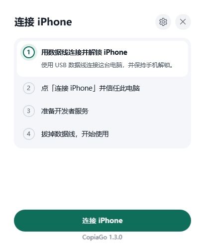
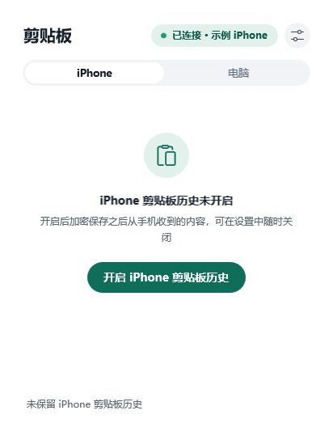
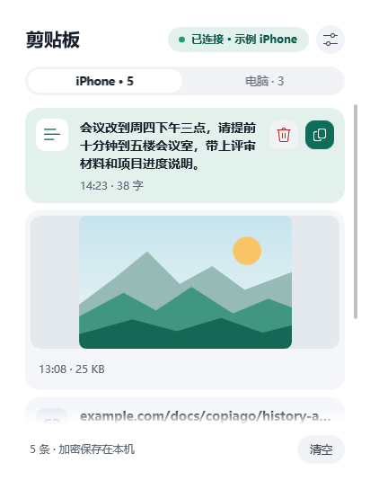

# CopiaGo

[English](README.md) · **简体中文**

在 iPhone 上复制，在 Windows 上直接粘贴。首次用 USB 配对，之后在同一局域网内无线同步。iPhone 无需安装 App。

**[下载安装包（Windows x64）](https://github.com/xgod1862/CopiaGo/releases/latest)**

## 系统要求

| | 要求 |
| --- | --- |
| iPhone | **iOS 17 或更高版本**（即 iPhone XS / XR 及之后的机型）。需开启开发者模式，CopiaGo 会引导开启。**iOS 16 及更早版本不支持。** |
| Windows | **Windows 10 21H2（版本 19044）或更高版本，含 Windows 11**，x64。需要 Apple 的设备连接组件，缺少时 CopiaGo 会提示安装 [Apple Devices](https://support.apple.com/en-us/118290)。 |
| 网络 | 首次配对需要数据线。之后无线同步要求电脑和 iPhone 在可互相发现的同一局域网内。首次准备开发者服务时需联网下载约 18 MB 的组件并请求 Apple 签名。 |

## 体积与占用

1.3.0 用 Rust 重写，与 Python 版 1.2.0 对比：

| 项目 | 1.3.0 | 1.2.0（Python） |
| --- | ---: | ---: |
| 安装包 | 3.7 MB | 25 MB |
| 便携版 ZIP | 1.9 MB | — |
| 安装后占用 | 7.9 MB（程序本身 3.4 MB，其余为卸载程序） | 74 MB |
| 托盘待机内存 | 约 3.5 MB | 约 71 MB |
| 打开面板时内存 | 约 10–12 MB | — |
| 待机 CPU | 约 0.1%（单个逻辑核心） | — |
| 启动到无线连上 | 约 2 秒 | — |

内存为进程专用内存（私有提交），在 Windows 11 x64、真实 iPhone 无线连接下测得；面板关闭后会归还内存，任务管理器中约 3 MB。开发者组件约 18 MB，首次连接时下载到数据目录，不计入安装后占用。

## 快速开始

1. 在 Windows 运行安装包。
2. 用数据线连接并解锁 iPhone。按手机提示点「信任」，按 CopiaGo 提示开启 [开发者模式](https://developer.apple.com/documentation/xcode/enabling-developer-mode-on-a-device)。
3. 在 CopiaGo 中点击「连接 iPhone」。配对完成后拔线，等托盘面板显示「已连接（无线）」。
4. 在 iPhone 上复制一段文字，在 Windows 应用中按 `Ctrl+V`。

安装器和 CopiaGo 默认按 Windows 显示语言选择简体中文或英文。在应用的「设置 → 语言」可改为手动选择，也可恢复「跟随系统」。

### 从旧版升级

直接运行新安装包即可，配对记录、历史和设置都会保留，无需重新配对。原来装在默认目录 `%LOCALAPPDATA%\Programs\iPhoneClipboard` 的，会自动移到 `%LOCALAPPDATA%\Programs\CopiaGo`；自选的安装目录保持不变。

## 界面截图

| 首次配对 | 托盘弹窗 | 剪贴板历史 |
| --- | --- | --- |
| [](docs/images/first-pairing.png) | [](docs/images/tray-popup.png) | [](docs/images/clipboard-history.png) |

截图来自 CopiaGo 1.3.0，连接状态和历史记录使用示例数据。

## 同步范围

| 方向 | 内容 | 默认行为 |
| --- | --- | --- |
| iPhone → Windows | 文字、图片、「文件」App 中复制的文件 | 自动同步，大文件先询问 |
| Windows → iPhone | 文字、图片 | 在设置里开启自动同步，或从电脑历史手动发送 |

- 双端历史默认关闭，开启后可在 Windows 托盘面板查看、复制、发送和清除。
- 能否粘贴图片取决于来源应用提供的剪贴板内容。若应用只提供文字或文件名，可先保存到「照片」再复制。照片 App 中的视频复制暂不支持。
- 手机离开网络后，CopiaGo 会在它重新上线时自动重连，无需打开面板。

## 隐私

- 无线传输走已配对设备的加密隧道。CopiaGo 不使用云端中转剪贴板。
- 配对记录及启用后的历史正文与预览由 [Windows DPAPI](https://learn.microsoft.com/en-us/windows/win32/api/dpapi/nf-dpapi-cryptprotectdata) 保护。接收的文件会暂存在数据目录的 `received` 文件夹。
- 仅在可信的 Windows 电脑上配对。停用时可在托盘设置中选「忘记此 iPhone」。
- 每次启动约 15 秒后，CopiaGo 会向 GitHub 查询一次最新版本，有新版时在托盘面板底部提示，不会自动下载或安装。GitHub 会看到这台电脑的 IP 地址和 CopiaGo 版本号。可在设置中关闭「启动时检查新版本」。

## 从源码构建

CopiaGo 使用 Rust 编写，源码在 [`copiago-rs`](copiago-rs)。安装 [rustup](https://rustup.rs/) 后，工具链版本由 `rust-toolchain.toml` 自动选择。

```powershell
Set-Location copiago-rs
cargo test --workspace --locked
cargo build --release --locked
```

打包安装程序和便携版另需 [Inno Setup 6](https://jrsoftware.org/isinfo.php)，在仓库根目录运行：

```powershell
.\copiago-rs\scripts\build.ps1 -IsccPath 'C:\Program Files (x86)\Inno Setup 6\ISCC.exe'
```

产物位于 `copiago-rs\target\packages`。更多构建、测试和升级验收说明见 [copiago-rs/README.md](copiago-rs/README.md)。1.2.0 及更早的 Python 版本代码保留在 git 历史和 [`v1.2.0`](https://github.com/xgod1862/CopiaGo/tree/v1.2.0) 标签中。

## 反馈与许可

通过 [GitHub Issues](https://github.com/xgod1862/CopiaGo/issues/new) 反馈。请附上 Windows、iOS、CopiaGo 版本和复现步骤，并移除配对记录、剪贴板内容及其他个人信息。

项目采用 [GPL-3.0-or-later](LICENSE)。随安装包分发的第三方许可声明会安装到程序目录的 `licenses` 文件夹。感谢 [idevice](https://github.com/jkcoxson/idevice)、[pymobiledevice3](https://github.com/doronz88/pymobiledevice3)、[Relais](https://github.com/williamcachamwri/Relais) 和 [Inno Setup 简体中文翻译](https://github.com/kira-96/Inno-Setup-Chinese-Simplified-Translation)。
